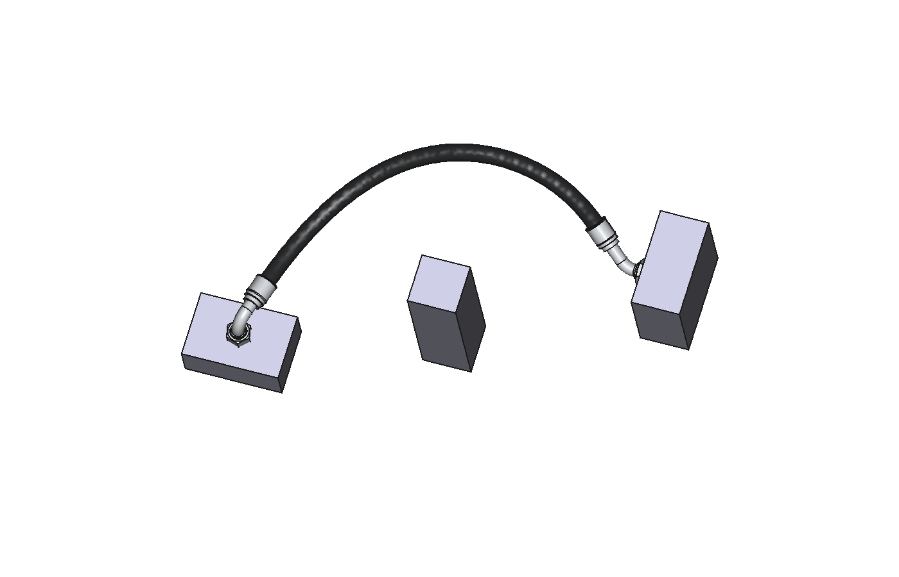

# Letkupaja – hydraulic hose routing for FreeCAD

Route a hydraulic hose between two ports in your FreeCAD model (also in App::Part, App::Link and Assembly
assemblies), see the exact cut length and the minimum bend radius immediately, and optionally order exactly this
hose from Letkupaja (https://letkupaja.fi), a Finnish maker of crimped hydraulic hose assemblies.

*Suomeksi alempana.*

## Features

* **Route hose:** pick two ports (the circular edge of a hole or a pin). Fittings are placed at the ports, angled
  fittings are swung to the best position and the hose never goes below its minimum bend radius. Optional obstacles
  and a target cut length.
* **Results:** cut length (order length), overall length, minimum bend radius (red if too small), clearance to
  obstacles and orientation. The drawn hose is exactly the curve whose radius and length are reported.
* **Free simplified fittings** with correct outer dimensions (nut, hex, elbow body, ferrule, banjo eye).
* **Copy order link / Open in Letkupaja:** opens the same hose in Letkukone, Letkupaja's online hose configurator
  (https://letkupaja.fi/#rakenna, in Finnish), with the hose, size, fittings, protection, cut length and
  orientation filled in.
* **Import Letkupaja STEP** and **Update hoses** after moving machine parts.
* Finnish and English user interface.

## What works and what is not free

* Routing, measurements, simplified fittings and the order link work offline and without an account.
* **Detailed fitting models (STEP)** are a Letkupaja service and need a Letkupaja account (sign-in with a device code
  in your browser). They are free for assemblies you have ordered or bought (same hose type, size, fittings and
  protection, any length and orientation), and the models included in your contract pricing download without a
  separate purchase. Otherwise a model costs €3.00 + VAT (€3.77 incl. Finnish VAT), paid in your browser at
  letkupaja.fi and credited when you order hose assemblies within 12 months.
* Designing regularly or ordering hoses in series? We offer companies contract pricing, which can also cover the 3D
  models. Ask about contract pricing: ville@laitehuoltotiensuu.fi.
* The Letkupaja web shop is in Finnish and delivers within Finland only. The workbench works everywhere.

## Requirements

FreeCAD 1.0 or newer (tested with 1.0.0 and 1.1.4 on Linux). No extra Python packages. The manifest accepts
FreeCAD 0.21 only so that a FreeCAD 0.21 user sees a clear message instead of a silently skipped workbench; FreeCAD
0.21 is not supported.

## Installation

**With the Addon Manager (recommended, updates in FreeCAD):**

1. Open *Edit › Preferences › Addon Manager* (or the gear button in the Addon Manager window).
2. Under *Custom repositories*, press **+** and enter the repository URL `https://github.com/viltie/letkupaja-freecad`
   and the branch `main`. Press *OK*.
3. Open *Tools › Addon Manager*, search for **Letkupaja** and press *Install*.
4. Restart FreeCAD and choose the **Letkupaja** workbench.

Update: *Tools › Addon Manager › Check for Updates*, then update Letkupaja. If you installed an earlier version from
the zip package, delete the folder `Mod/Letkupaja` (under `App.getUserAppDataDir()`) first so that only one copy is
loaded.

**From the zip package:** download `Letkupaja-FreeCAD-<version>.zip` from https://letkupaja.fi/cad-lisaosat?lang=en#freecad,
extract it, open `Asenna-Letkupaja.FCMacro` in FreeCAD (*File › Open*) and run it (*Macro › Execute macro*). The
macro copies the workbench into this FreeCAD's `Mod` folder.

## Usage

1. Open your machine model and press *Route hose*.
2. Choose the hose type, size, protection and both fittings, or paste a Letkupaja link and press *Read link*.
3. Select the circular edge (or cylindrical face) of port A in the 3D view and press *Pick A*; same for B.
4. Optionally select nearby parts as obstacles and set a target cut length.
5. Check the cut length, bend radius and warnings, then *Copy order link* or *Open in Letkupaja*.

The fitting is placed so that its sealing point is at the picked point (flat face for ORFS and SAE flanges, the
sealing face around the bolt hole for banjos, the cone tip for 24° and 60° cones). *Offset (mm)* moves the point
along the port axis. Dimensions are indicative; verify installation dimensions before ordering.

## Network connections and privacy

* No telemetry. The workbench connects only to https://letkupaja.fi and only when you press *Check for updates*,
  *Sign in*, *Sign out* or *Download detailed model*. Nothing is sent at start-up.
* *Check for updates* reads the latest version number and the latest dimension data (`/cad/geometry.json`).
* Requests include the add-on version (User-Agent). Signing in stores a device name made of the FreeCAD version and
  operating system. Fetching a detailed model sends only the hose selections. Your model geometry is never sent.
* The sign-in token is stored only on this computer in a file readable only by you: Windows
  `%LOCALAPPDATA%\Letkupaja\FreeCAD\token.json`, macOS/Linux `<App.getUserAppDataDir()>/Letkupaja/token.json`.
  Devices can be revoked at https://letkupaja.fi/tili?lang=en#cad-lisaosat
* Privacy notice: https://letkupaja.fi/tietosuoja#cad-lisaosat

## License

Code: LGPL-2.1-or-later (see `LICENSE`), including the routing library `letkupaja_fc/letkuroute`. The hose and
fitting dimension data (`letkupaja_fc/letkuroute/data/geometry.json`): see `LICENSE-Data`; it may be redistributed
unchanged as part of this add-on. Detailed models and use of Letkupaja's services (sign-in, detailed models, orders):
https://letkupaja.fi/ehdot#cad-lisaosat

## Support

Issues: https://github.com/viltie/letkupaja-freecad/issues · ville@laitehuoltotiensuu.fi · +358 43 211 0516
(Mon–Fri 8–16 Finnish time) · https://letkupaja.fi/yhteystiedot

## About Letkupaja

Letkupaja (Laitehuolto Tiensuu Oy, Koski, Finland) crimps and flushes hydraulic hose assemblies to order, usually
within 1–2 working days. The workbench uses the same hose and fitting dimension data as Letkukone, so the routed
hose, its cut length and the order link describe the same hose. Every assembly is available as a STEP model
(AP214, mm), free with ordered assemblies. Companies in Finland can pay by invoice (14 days net), choose Express
delivery to a business address and ask for contract pricing. More: https://letkupaja.fi/cad-lisaosat?lang=en

---

## Suomeksi

**Letkupaja-työpöytä FreeCADiin:** reititä hydrauliikkaletku kahden liitännän välille FreeCAD-mallissa (myös
App::Part-, App::Link- ja Assembly-kokoonpanoissa), näe katkaisumitta ja pienin taivutussäde heti ja tilaa halutessasi
juuri tämä letku Letkupajasta (https://letkupaja.fi). Reititys, mitat, yksinkertaistetut liittimet ja tilauslinkki
toimivat ilman tiliä ja ilman verkkoa. Tarkat liitinmallit (STEP) ladataan Letkupaja-tilillä: ne ovat maksuttomia
tilaamillesi ja ostamillesi asennelmille, ja sopimushinnoittelusi mukaiset mallit ladataan ilman erillistä ostoa;
muuten malli maksaa 3,00 € + alv (3,77 € sis. alv), ja hinta hyvitetään, kun tilaat letkuasennelmia 12 kuukauden
kuluessa. Suunnitteletteko säännöllisesti tai tilaatteko letkuja sarjoina? Teemme yrityksille sopimushinnoittelun,
joka voi kattaa myös 3D-mallit. Kysy sopimushinnoista: ville@laitehuoltotiensuu.fi.

**Vaatimukset:** FreeCAD 1.0 tai uudempi (testattu 1.0.0 ja 1.1.4 Linuxissa).

**Asennus Addon Managerilla (suositus, päivitykset FreeCADissa):**

1. Avaa *Muokkaa › Asetukset › Addon Manager* (tai Addon Managerin rataspainike).
2. Lisää *Custom repositories* -kohtaan (**+**) osoite `https://github.com/viltie/letkupaja-freecad` ja haara
   `main`. Paina *OK*.
3. Avaa *Työkalut › Addon Manager*, hae **Letkupaja** ja paina *Install*.
4. Käynnistä FreeCAD uudelleen ja valitse työpöydäksi **Letkupaja**.

Päivitys: *Työkalut › Addon Manager › Check for Updates*. Jos asensit aiemman version zip-paketista, poista ensin
kansio `Mod/Letkupaja` (`App.getUserAppDataDir()`-kansion alla), jotta käytössä on vain yksi kopio.

**Zip-paketista:** lataa `Letkupaja-FreeCAD-<versio>.zip` osoitteesta https://letkupaja.fi/cad-lisaosat#freecad,
pura se, avaa FreeCADissa `Asenna-Letkupaja.FCMacro` (*Tiedosto › Avaa*) ja suorita se (*Makro › Suorita makro*).

**Tietosuoja:** ei käyttötietojen keruuta. Lisäosa ottaa yhteyttä vain osoitteeseen https://letkupaja.fi ja vain,
kun painat *Tarkista päivitykset*, *Kirjaudu*, *Kirjaudu ulos* tai *Lataa tarkka malli*. Mallisi geometriaa ei
lähetetä. Tietosuojaseloste: https://letkupaja.fi/tietosuoja#cad-lisaosat

**Lisenssi:** ohjelmakoodi LGPL-2.1-or-later (`LICENSE`), mittadata `LICENSE-Data`, palvelujen käyttöehdot
https://letkupaja.fi/ehdot#cad-lisaosat

**Tuki:** ville@laitehuoltotiensuu.fi, puhelin +358 43 211 0516 (ma–pe 8–16), https://letkupaja.fi/yhteystiedot

Mitat ovat ohjeellisia; tarkista asennusmitat ennen tilausta.
